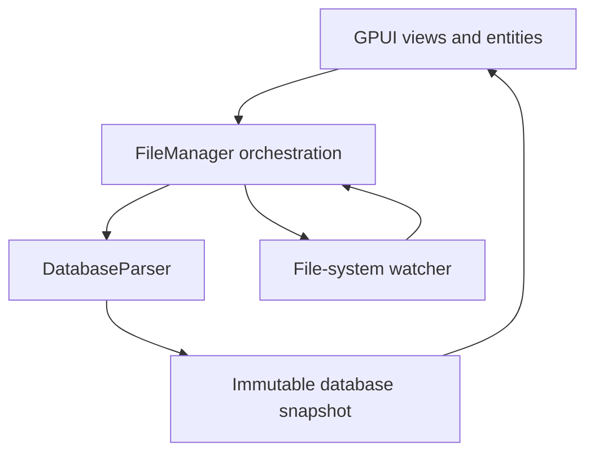

# Architecture Specification

**Status:** Active

## Components

- `src/parser/` reads bytes and produces immutable database snapshots.
- `src/file_manager.rs` owns parse cancellation, file watching, and lifecycle events.
- `src/ui/` owns presentation and interaction state.
- `src/models.rs` contains the data exchanged between parser and UI.

## Invariants

- **ARCH-001:** Parser code has no GPUI dependency and is testable without an application window.
- **ARCH-002:** File parsing and other blocking I/O execute off the GPUI foreground thread.
- **ARCH-003:** A published `DatabaseInfo` is immutable and internally consistent.
- **ARCH-004:** Every byte offset, page count, and allocation derived from file data uses checked conversion and arithmetic.
- **ARCH-005:** Truncated reads, invalid page sizes, and impossible page headers return errors; they do not panic.
- **ARCH-006:** Starting a new open or refresh operation cancels or supersedes the previous operation.
- **ARCH-007:** At most one active watcher belongs to the current database, and replacing or closing it releases the old watcher.
- **ARCH-008:** Background failures propagate through typed events to user-visible status.
- **ARCH-009:** Rendering may read snapshots but must not perform file I/O or unbounded parsing.

## Dependency direction

UI may depend on orchestration and models. Orchestration may depend on parser and models. Parser may depend on models. Models must not depend on UI; GPUI-specific colors currently in `models.rs` are known technical debt that should move to presentation code.

## Change guidance

Prefer pure functions for validation, arithmetic, selection transitions, and parser logic. Wrap those functions with GPUI entities rather than embedding behavior in event handlers. Add an architecture decision under `docs/decisions/` when changing a component boundary, concurrency model, persistent format, or core dependency.
